# Ретранслятор брелока від шлагбаума

Я хотів зробити такий собі ретранслятор для ключа від шлагбаума (433.92 MHz, OOK). Пристрій слухає ефір, ловить сигнал, захоплює його у визначеному вікні й відтворює назад в ефір.

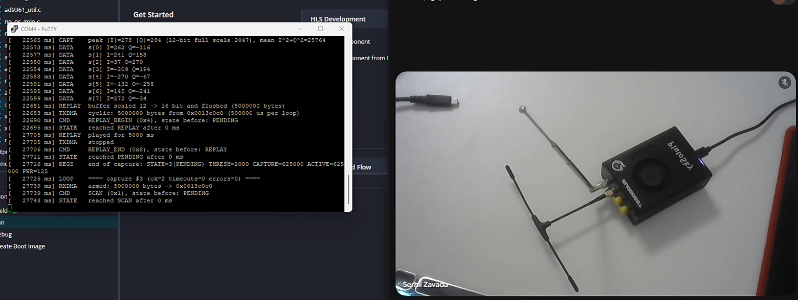

## Як я це робив

У мене китайський клон плати Analog Devices: Zynq-7020 і AD9361. Я написав китайцям, і вони скинули сорси. Далі в мене вийшло ці сорси зібрати й запустити. Я переробив проєкт на Tcl-скрипти, щоб він піднімався з нуля однією командою.

Потім я брейнштормив з AI і прийшов до того, що мені треба зробити кастомний IP. Він встає між блоком, який готує пакети з IQ-семплами (`util_cpack2`), і DMA-контролером, який пише їх у DDR (`axi_dmac`). Між цими блоками дуже простий інтерфейс `fifo_wr`: фактично це шина даних і `wr_en`, сигнал дозволу на запис.

Мій блок стає посередині й рахує амплітуду, точніше потужність I² + Q² кожного семпла. Якщо вона кілька семплів поспіль більша за трешхолд, блок дозволяє запис у DDR. Але пише він тільки вікно фіксованої довжини. Всередині вікна він додатково рахує активну фазу сигналу, тобто скільки в цьому вікні справжнього сигналу, а не тиші. Саме цей шматок програма потім і відтворює.

Коли сигнал відтворюється, детектор вимкнений, щоб плата не почула сама себе й не зациклилась. Саме відтворення у FPGA я не чіпав, там стандартний TX-пайплайн ADI, а вся логіка в C-коді. Усім цим керує автомат станів (FSM). Через AXI-Lite можна конфігурувати блок (трешхолд, команди) і навпаки читати параметри: стан FSM, поточну потужність, довжину активної фази тощо.

У цьому проєкті я попрацював буквально з усім, що було на курсі:
- свій RTL і FSM, множення на DSP;
- AXI-Lite;
- тестбенчі;
- CDC між двома тактовими доменами;
- пакування IP, block design і Zynq із DMA.

Навіть довелося покопатися в оптимізації після розводки: у китайських сорсах ще без моїх змін був від'ємний WHS. Про це нижче, в пункті 7.

## Що варто подивитись

Головна частина проєкту — мій IP у папці [`hw/mylibrary/zavadi_rf_capture/`](hw/mylibrary/zavadi_rf_capture/). Там:
- [`zavadi_rf_capture.sv`](hw/mylibrary/zavadi_rf_capture/zavadi_rf_capture.sv) — топ, де все з'єднано;
- [`capture_fsm.sv`](hw/mylibrary/zavadi_rf_capture/capture_fsm.sv) — автомат;
- [`power_detector.sv`](hw/mylibrary/zavadi_rf_capture/power_detector.sv) — детектор потужності;
- [`record_counter.sv`](hw/mylibrary/zavadi_rf_capture/record_counter.sv) — лічильник вікна й активної фази;
- [`gate_cdc.sv`](hw/mylibrary/zavadi_rf_capture/gate_cdc.sv) — перехід між AXI-доменом і доменом даних.

AXI-Lite окремо:
- [`axi_lite_cfg.sv`](hw/mylibrary/zavadi_rf_capture/axi_lite_cfg.sv) — сам модуль;
- [`tb_axi_lite_cfg.sv`](hw/mylibrary/zavadi_rf_capture/tb_axi_lite_cfg.sv) — його тест;
- [`axi_lite_cfg_broken_for_test_on_purpose.sv`](hw/mylibrary/zavadi_rf_capture/axi_lite_cfg_broken_for_test_on_purpose.sv) — навмисно зламана копія.

IP я пакую Tcl-скриптами по аналогії з ADI. Я взяв їхні хелпери (`adi_ip_create`, `adi_add_bus` і т. д.), щоб мій блок мав такий самий інтерфейс `fifo_wr`, як і їхні, і просто вставлявся між ними. Самі скрипти:
- [`build_mylib.tcl`](hw/mylibrary/build_mylib.tcl) — пакує всі мої IP;
- [`scripts/zavadi_ip.tcl`](hw/mylibrary/scripts/zavadi_ip.tcl) — спільний сетап і мій vendor;
- [`zavadi_rf_capture_ip.tcl`](hw/mylibrary/zavadi_rf_capture/zavadi_rf_capture_ip.tcl) — опис самого IP.

Сам проєкт Vivado:
- [`create_project.tcl`](hw/zynq_project/create_project.tcl) піднімає все з нуля;
- block design лежить у [`bd/system_bd.tcl`](hw/zynq_project/bd/system_bd.tcl);
- констрейни — у [`constr/system_constr.xdc`](hw/zynq_project/constr/system_constr.xdc).

C-додаток ([`sw/src/`](sw/src/)) і збірка платформи у Vitis ([`sw/build.py`](sw/build.py)) були повністю vibecoded. Часу не вистачало, і ця частина мені найменш цікава, тому її прошу не оцінювати. Фактично там ініціаліація AD9361 і DMA + логіка роботи з моїм IP (вичітка параметрів і керування автоматом по axi-lite)

## AXI-Lite регістри
| Адреса | Регістр | Доступ | Що означає |
|---|---|---|---|
| `0x00` | `CMD` | програма пише | Команди: біт 0 `SCAN`, 1 `RESET`, 2 `REPLAY_BEGIN`, 3 `REPLAY_END`. Записана одиниця перемикає свій біт, а в домені даних це перетворюється на один імпульс. |
| `0x04` | `STATE` | програма читає | Поточний стан FSM, 0..4. |
| `0x08` | `THRESHOLD` | пише і читає | Трешхолд потужності I² + Q² одного семпла. Після ресету `0xFFFF_FFFF`, щоб нічого не спрацювало, поки програма не виставить нормальне значення. |
| `0x0C` | `CAPTURE_SAMPLES` | програма читає | Довжина вікна в 64-бітних словах (по 2 семпли в слові). По ній програма знає, скільки пам'яті потрібно під буфер. |
| `0x10` | `ACTIVE_SAMPLES` | програма читає | Скільки слів у вікні займає сам сигнал. Валідне в `PENDING`, саме стільки програма потім відтворює. |
| `0x14` | `PWR` | програма читає | Потужність останнього семпла. Нею програма міряє шум, щоб виставити трешхолд, і пише в лог. |

## FSM

| Код | Стан | Що відбувається |
|---|---|---|
| 0 | `IDLE` | Спокій. По команді `SCAN` переходимо в `SCAN`. |
| 1 | `SCAN` | Детектор увімкнений, у DDR нічого не пишеться. Як тільки потужність тримається вище трешхолду 16 семплів поспіль і DMA готовий приймати, переходимо в `CAPTURE`. |
| 2 | `CAPTURE` | `wr_en` проходить до DMA, пишеться вікно. Паралельно рахується активна фаза: вона закінчується, коли сигналу немає 25 мс. Коли вікно записане, переходимо в `PENDING`. |
| 3 | `PENDING` | Захоплення лежить у DDR, детектор вимкнений. Звідси або `REPLAY_BEGIN` у `REPLAY`, або `SCAN` знову в `SCAN`. |
| 4 | `REPLAY` | Програма відтворює сигнал, детектор вимкнений, щоб не спрацювати на самого себе. По `REPLAY_END` повертаємось у `PENDING`. |

Команда `RESET` з будь-якого стану кидає FSM в `IDLE`. Вікно у проєкті — 625000 слів, тобто 1.25 млн семплів, або пів секунди при 2.5 MS/s.

## Тест AXI-Lite і очікувані значення

Тест сам порівнює результат з очікуваним. Якщо щось не так, він друкує `Error: ...`, а в кінці пише `tb_axi_lite_cfg: done`. Якщо до `done` немає жодного `Error`, тест пройшов (PASS); якщо є хоч один — FAIL.

Очікувані значення я порахував руками до запуску:

| Сценарій | Що робимо | Що має бути |
|---|---|---|
| Запис і читання | пишу `THRESHOLD = 1234567` | `BRESP = 00`, на виході `threshold = 0x0012D687` |
| | читаю `THRESHOLD` | `RDATA = 0x0012D687`, `RRESP = 00` |
| Регістр тільки на запис | пишу в `CMD` `1010` | `BRESP = 00`, `cmd_tgl = 0000 ^ 1010 = 1010` |
| | читаю `CMD` (помилковий випадок) | `RRESP = 11` |
| Регістр тільки на читання | пишу в `PWR` (помилковий випадок) | `BRESP = 11` |
| | читаю `PWR`, коли `pwr = 123` | `RDATA = 0x7B`, `RRESP = 00` |
| Неіснуюча адреса `0xFFF` | пишу | `BRESP = 11` |
| | читаю | `RRESP = 11` |

---

## Критерії оцінювання

| № | Що зробити | Виконання |
|---|---|---|
| 1 | IP з 3–5 регістрами AXI4-Lite, логіка, таблиця регістрів | done |
| 2 | Тестбенч з PASS/FAIL, ≥ 3 сценаріїв, очікувані значення в README | done |
| 3 | Зламана копія модуля, на якій тест падає | done |
| 4 | Package IP і IP Catalog | done |
| 5 | Block Design, Validate, Address Editor | done, з Zynq замість MicroBlaze |
| 6 | Симуляція всієї системи з C-програмою | не done, пояснення нижче |
| 7 | Implementation, ресурси IP і WNS | done |

### 1. IP і регістри

Логіка IP лежить у [`hw/mylibrary/zavadi_rf_capture/`](hw/mylibrary/zavadi_rf_capture/), AXI-Lite — в [`axi_lite_cfg.sv`](hw/mylibrary/zavadi_rf_capture/axi_lite_cfg.sv). Регістрів шість, таблиця [вище](#axi-lite-регістри).

### 2. Тестбенч

Тестбенч — [`tb_axi_lite_cfg.sv`](hw/mylibrary/zavadi_rf_capture/tb_axi_lite_cfg.sv), у ньому чотири сценарії. Три з них помилкові або граничні: читання з регістра тільки на запис, запис у регістр тільки на читання і неіснуюча адреса. Очікувані значення в таблиці [вище](#тест-axi-lite-і-очікувані-значення).

У консолі жодного `Error`, тільки `done`:

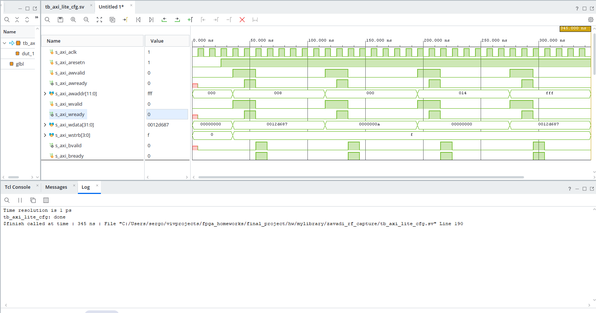

На хвилях видно записи й читання по адресах `0x008`, `0x000`, `0x014`, `0xFFF` і відповіді на них:

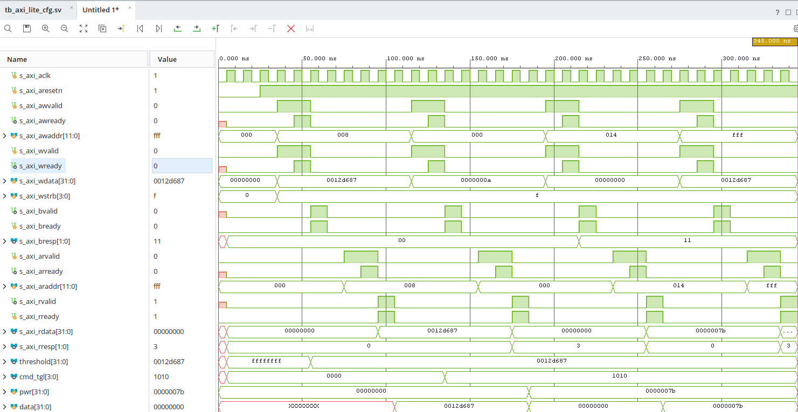

### 3. Зламана копія

[`axi_lite_cfg_broken_for_test_on_purpose.sv`](hw/mylibrary/zavadi_rf_capture/axi_lite_cfg_broken_for_test_on_purpose.sv) — копія, в якій я закоментував запис `s_axi_rdata`, `cmd_tgl` і `threshold_reg`.
Тест на ній падає з чотирма помилками: трешхолд не записався, читання повертає нулі, а `cmd_tgl` лишився `0000`:

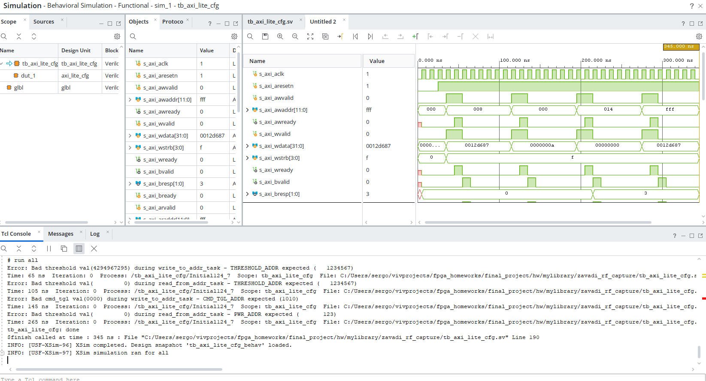

### 4. IP Catalog

IP пакується скриптом [`zavadi_rf_capture_ip.tcl`](hw/mylibrary/zavadi_rf_capture/zavadi_rf_capture_ip.tcl). Папку `hw/mylibrary` [`create_project.tcl`](hw/zynq_project/create_project.tcl) додає в репозиторії IP, після чого блок знаходиться в каталозі:

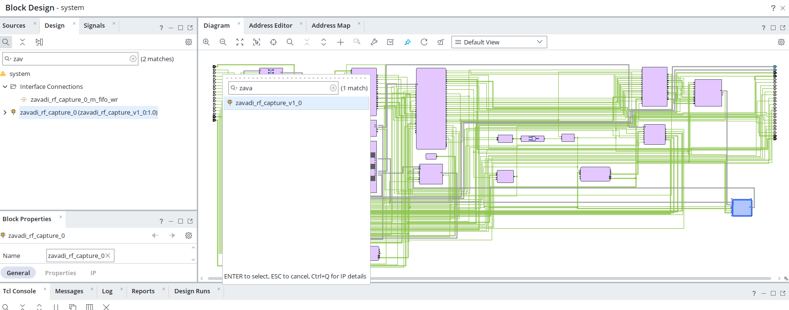

### 5. Block Design

Замість MicroBlaze в мене Zynq, бо плата на Zynq-7020, і весь пайплайн AD9361 + DMA + DDR будується навколо нього. Ось увесь дизайн, мій блок виділений синім:

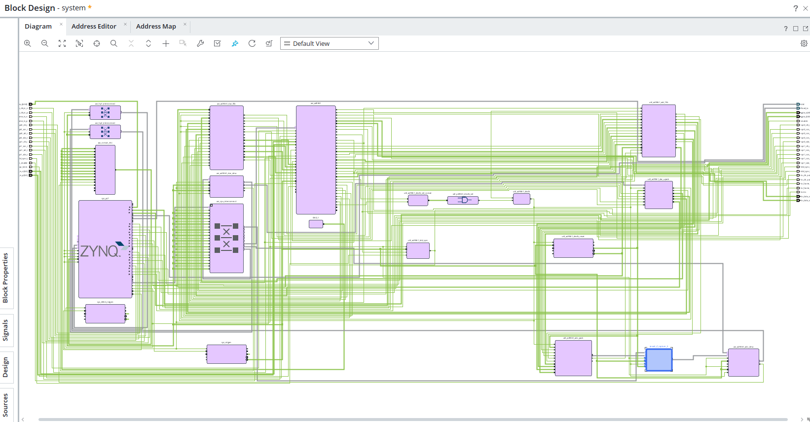

А ось він ближче, між `util_ad9361_adc_pack` і `axi_ad9361_adc_dma`:

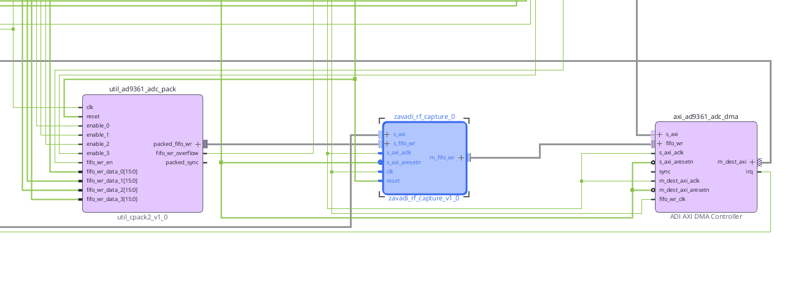

Валідація проходить:

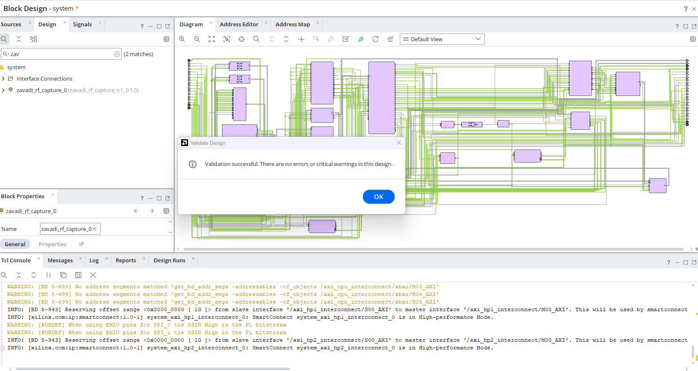

В Address Editor блок отримав адресу `0x43C0_0000`:

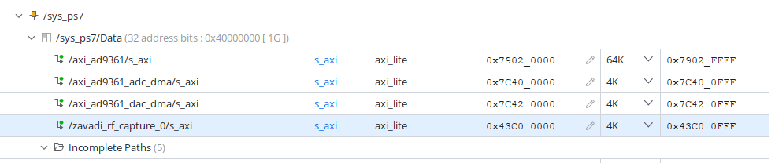

### 6. Симуляція всієї системи — не done

Тут у мене Zynq замість MicroBlaze, а програму на ARM-ядрі в симуляції Vivado просто так не запустиш. Узяти MicroBlaze під цей проєкт теж не вийде: потрібна DDR, бо одне захоплення займає 5 MB, і семпли не влізли б у BRAM.

Натомість ось робочий проєкт на платі. C-код, який пише й читає регістри мого блока, лежить у [`sw/src/rf_capture.c`](sw/src/rf_capture.c) і [`sw/src/main.c`](sw/src/main.c). У лозі видно повний цикл: `SCAN` → захоплення → `PENDING` → `REPLAY` → знову `SCAN`. У рядку `REGS` — значення, прочитані з регістрів: `STATE=3(PENDING) THRESH=2000 CAPTURE=625000 ACTIVE=625000 PWR=125`.


### 7. Implementation

Мій IP займає 183 LUT, 588 FF, 4 DSP і жодного BRAM. Чотири DSP — це I² і Q² для двох семплів у слові.

Увесь проєкт після implementation займає 11916 LUT (22 %), 19302 FF (18 %), 32 DSP (15 %) і 4 BRAM:

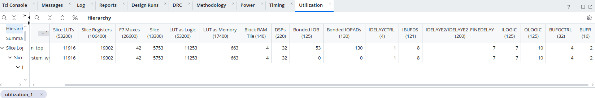

З таймінгом була історія. Китайські сорси ще без моїх змін мали від'ємний hold slack на `rx_clk` (250 MHz): WHS −0.047 ns, 14 шляхів не проходили.

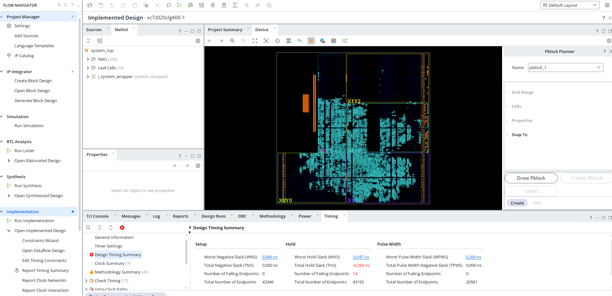

Я ввімкнув post-route `phys_opt_design` з `ExploreWithAggressiveHoldFix` (це в [`create_project.tcl`](hw/zynq_project/create_project.tcl)). Після цього WNS 0.084 ns і WHS 0.002 ns, усі шляхи проходять:

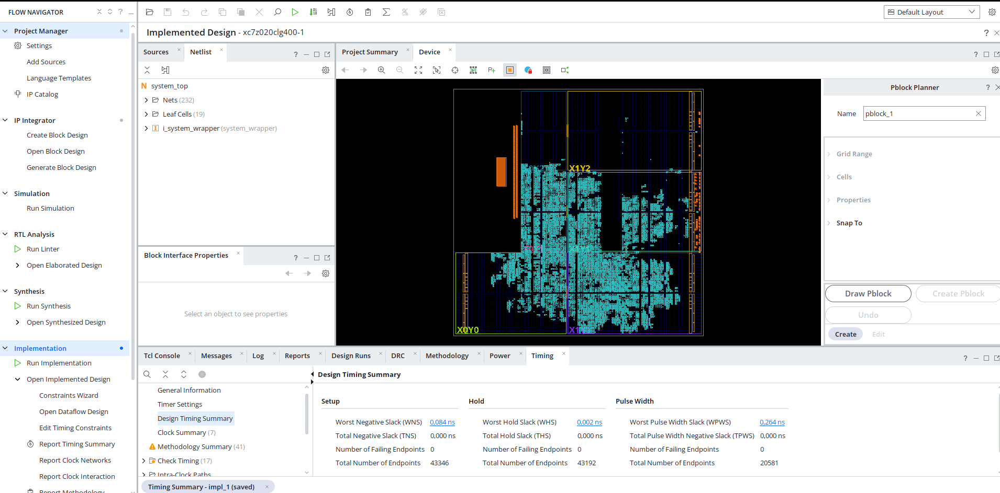

Проєкт вкладається в час: і setup, і hold додатні.
## Як розгорнути з нуля

Усе збирається скриптами. Скрипт пакує IP ADI і мій, створює проєкт із block design, проганяє implementation і кладе `build/system_top.xsa`:

```
cd hw/zynq_project
vivado -mode batch -source create_project.tcl -tclargs build
```

Потім Vitis, з папки `final_project`. Він створює платформу з `.xsa` і збирає C-додаток у `build/vitis`:

```
vitis -s sw/build.py
```

